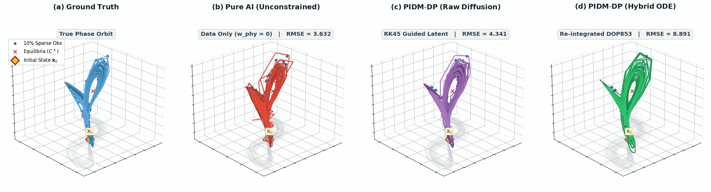
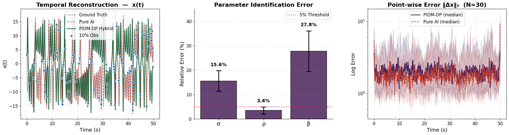

# PIDM-DP: Physics-Informed Diffusion for Chaotic Systems

[](LICENSE)


[](https://github.com/OWNER/pidm-dp-lorenz63/actions)

Reconstructing a chaotic trajectory **and** its governing parameters from only **10 % noisy observations**, using a diffusion model guided by a differentiable **Dormand–Prince RK45** physics residual. Test bed: the Lorenz-63 system.

<p align="center"></p>

## Overview

| Component | Description |
|---|---|
| Generative prior | 1D temporal U-Net (6 channels = x, y, z, σ, ρ, β), DDPM with T = 1000 linear-β steps |
| Observations | 10 % of time steps (default), Gaussian noise σ = 0.05 (normalised units) |
| Guidance | `w_data · MSE(x̂₀, y_obs)` + scheduled `w_phy · log(1 + MSE(RK45(x̂₀), x̂₀₊₁))`, gradient-normalised and clipped |
| Baselines | **Data-only diffusion** ("Pure AI", λ_phy = 0), **EnKF** (joint state–parameter, 50 members) |
| Ground truth | DOP853 (rtol 1e-8, atol 1e-10), 1000 points, dt = 0.05, 700-step transient discarded |
| Model scales | Full ≈ 2.93 M params · Micro ≈ 53 k params |
| Metrics | Trajectory RMSE, parameter MAE / range-normalised error / MAPE, Wilcoxon tests, Rosenstein Lyapunov |

Parameter ranges: σ ∈ [8, 12], ρ ∈ [20, 35], β ∈ [2, 4] (in-distribution). OOD: σ ∈ [5, 8], ρ ∈ [15, 20], β ∈ [1.5, 2].

## Results

All values are copied from the recorded notebook outputs (single run, seed 42, Tesla T4).

### Trajectory RMSE (mean ± std)

| Setting | PIDM-DP | Data-only | EnKF (oracle init.) |
|---|---|---|---|
| In-distribution, N = 30 | 4.16 ± 2.92 | 3.88 ± 2.60 | **2.25 ± 1.82** |
| Out-of-distribution, N = 30 | 2.31 ± 1.56 | 2.10 ± 1.45 | **1.16 ± 0.77** |
| Micro model (~53k), N = 15 | 11.82 ± 1.54 | 13.54 ± 1.60 | **1.87 ± 1.15** |

Wilcoxon signed-rank: PIDM-DP vs. data-only p = 0.092 (ID), 0.080 (OOD) → not significant; micro model p = 6e-5. PIDM-DP vs. EnKF p < 1e-5 in all settings (EnKF better).

### Parameter recovery (ID, N = 30)

| Parameter | MAE | NAE (% of range) | MAPE |
|---|---|---|---|
| σ | 1.97 ± 1.51 | 49.3 % | 20.0 % |
| ρ | 1.23 ± 1.14 | 8.2 % | 4.1 % |
| β | 0.60 ± 0.50 | 30.0 % | 20.3 % |

ρ is identified well; σ and β are weakly constrained by sparse data. Under OOD, ρ stays at ≈ 8 % MAPE while σ and β degrade (69 % / 53 %).

### Ablations

* **λ_phy sweep** (N = 10): PIDM-DP RMSE 3.84 / 4.21 / 3.71 / 3.69 / 4.04 for λ = 0 / 0.5 / 1 / 2 / 5 — differences are within trial-to-trial noise.
* **Noise × sparsity** (N = 10): PIDM-DP/data-only RMSE ratio ranges 0.77–1.06 across the 3 × 3 grid, i.e. no consistent gain.
* **ρ vs. observation density**: median MAPE 5.7 % (2 %), 7.5 % (5 %), 3.9 % (10 %), 2.8 % (20 %), 2.4 % (50 %).

<p align="center"></p>

### Honest takeaways

* With a well-conditioned data-guidance term (w_data = 150), the physics term did **not** give a statistically significant improvement at full scale in this single-seed study.
* The ~53 k model is much worse for both diffusion variants; physics guidance narrows but does not close the gap.
* The EnKF baseline is initialised at the true initial state and is therefore optimistic; treat it as an upper-bound reference.
* N is small (10–30 trials) and results come from one training seed. Multi-seed runs and a fairer EnKF initialisation are natural next steps.

## Repository layout

```
.
├── notebooks/pidm_dp_lorenz63.ipynb   # full pipeline with recorded outputs
├── assets/                            # figures used in this README
├── requirements.txt
├── CITATION.cff
├── CONTRIBUTING.md
├── LICENSE
└── .github/                           # CI + issue templates
```

## Getting started

```bash
git clone https://github.com/OWNER/pidm-dp-lorenz63.git
cd pidm-dp-lorenz63
python -m venv .venv && source .venv/bin/activate
pip install -r requirements.txt
jupyter lab notebooks/pidm_dp_lorenz63.ipynb
```

A CUDA GPU is strongly recommended (the original run used a Kaggle T4). The notebook auto-detects Kaggle (`/kaggle/working`) and otherwise writes `results/`, `models/` and `figures/` to the working directory. Intermediate results are checkpointed (`models/lorenz63/*.pkl`), so interrupted runs resume. Set `CONFIG["training"]["epochs"]` or `N_TRIALS` lower for a quick smoke test.

> Checkpoints are loaded with `torch.load(..., weights_only=False)`; only load checkpoints you created yourself.

## Reproducibility

Seeds are set via `set_seed` (default 42) and cuDNN is put in deterministic mode. Exact numbers can still vary across GPU/driver versions.

## Citation

See [`CITATION.cff`](CITATION.cff) (GitHub shows a "Cite this repository" button).

## License

MIT — see [LICENSE](LICENSE).
