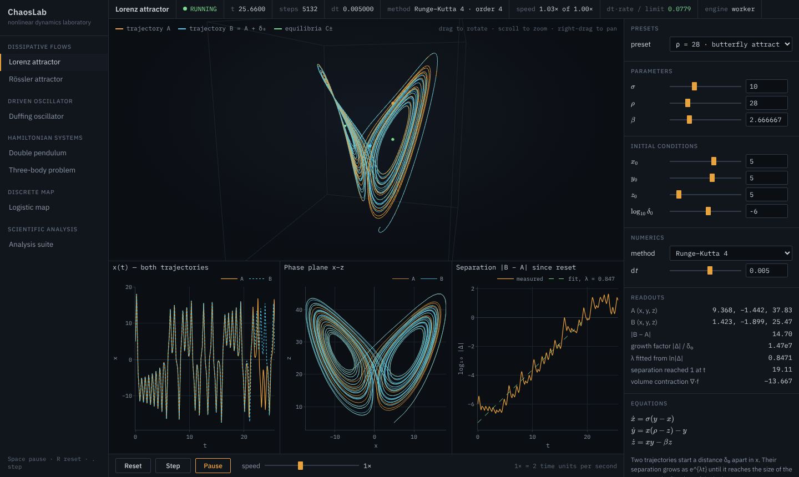
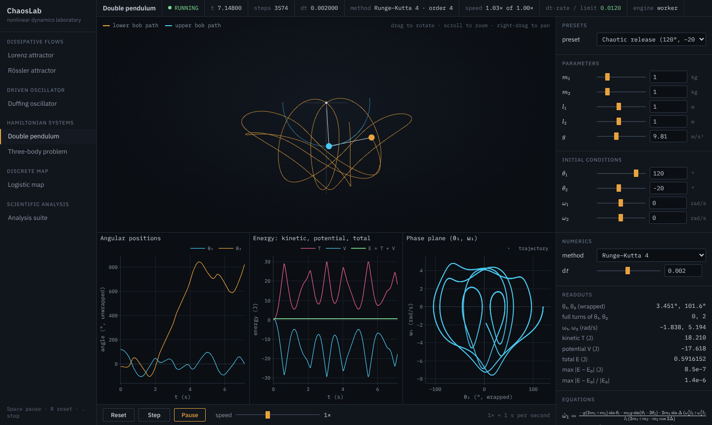
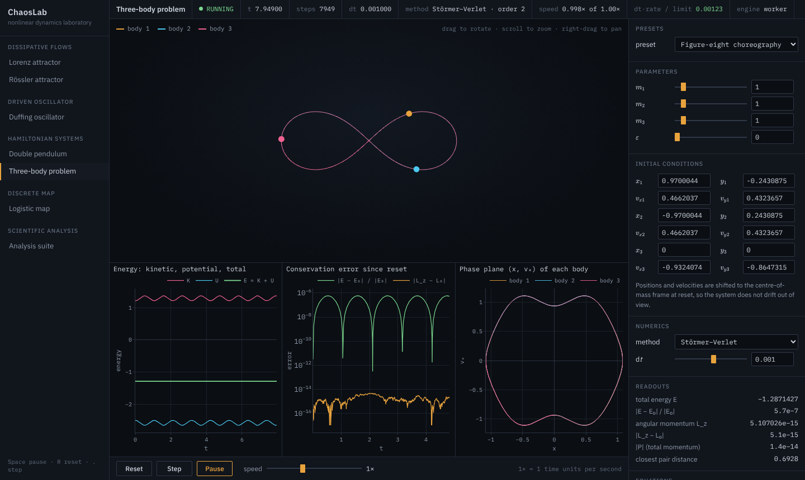
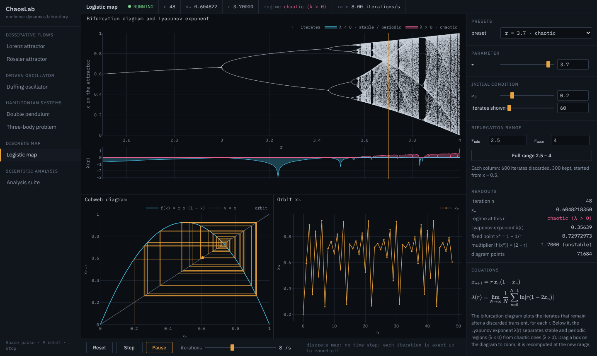
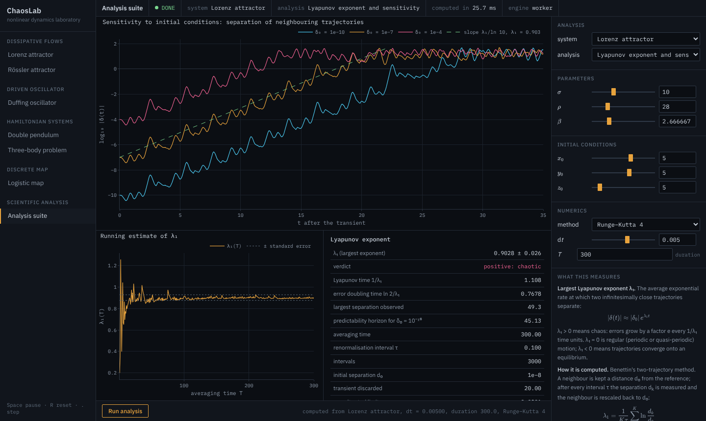
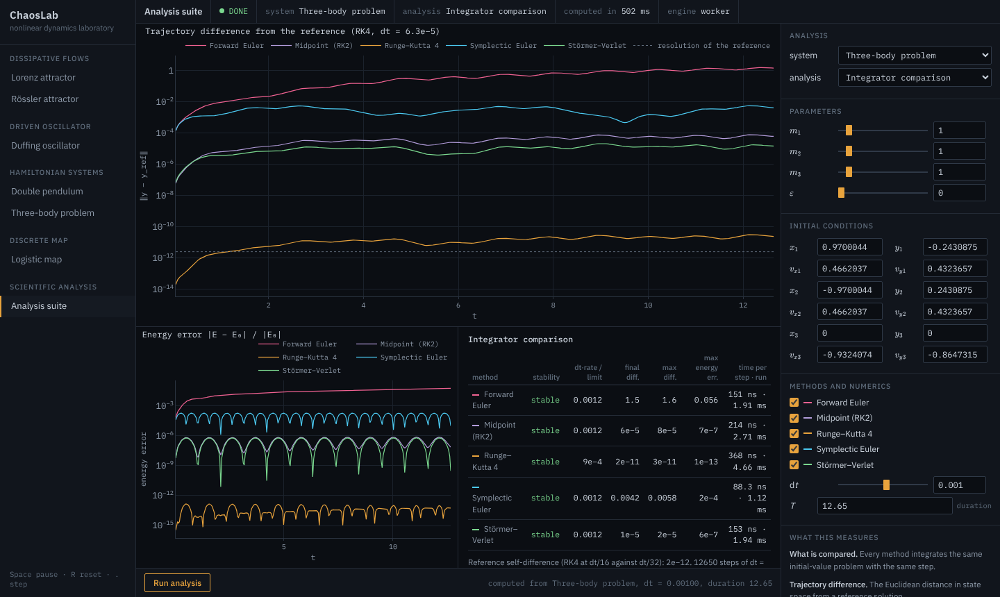
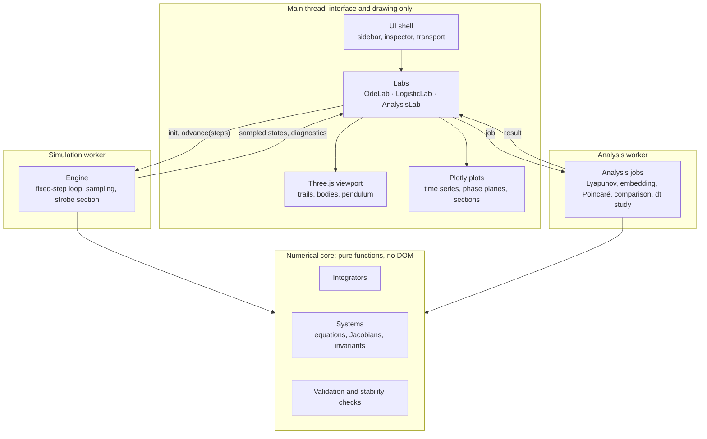

# ChaosLab

An interactive laboratory for chaotic dynamical systems, nonlinear dynamics and numerical integration, running entirely in the browser: https://shailendradabral.github.io/Scientific-machine-learning/chaoslab/ . 

ChaosLab is a numerical tool first and a visualisation second. Every curve on screen is produced by a named integrator at a stated step size, from equations you can read in the source, and every model ships with validation tests against analytic or published results.

- **No backend, no API keys, no accounts.** The build is a folder of static files. All computation runs in your browser, in Web Workers. Fonts and libraries are bundled, so it works offline once loaded.
- **Live demo:** after you enable GitHub Pages (see [Deployment](#deployment-to-github-pages)) the app is served at `https://<your-username>.github.io/<repository-name>/`.



## Contents

- [Features](#features)
- [Screenshots](#screenshots)
- [Installation](#installation)
- [Using the simulations](#using-the-simulations)
- [Mathematical background](#mathematical-background)
- [Numerical methods](#numerical-methods)
- [Analysis suite](#analysis-suite)
- [Architecture](#architecture)
- [Testing and validation](#testing-and-validation)
- [Deployment to GitHub Pages](#deployment-to-github-pages)
- [Known limitations](#known-limitations)
- [Scientific references](#scientific-references)
- [Contributing](#contributing)
- [License](#license)

## Features

**Six dynamical systems**

| System | Type | Highlights |
| --- | --- | --- |
| Lorenz attractor | Dissipative flow, 3D | Butterfly attractor, two trajectories a distance δ₀ apart, fitted divergence rate |
| Rössler attractor | Dissipative flow, 3D | Return map of successive maxima |
| Duffing oscillator | Driven, damped oscillator | Stroboscopic Poincaré section, potential-well view |
| Double pendulum | Conservative, non-separable | Physical pendulum, angle plots, kinetic/potential/total energy |
| Three-body problem | Hamiltonian, separable | Editable masses, positions and velocities; energy and angular-momentum conservation |
| Logistic map | Discrete map | Zoomable bifurcation diagram, Lyapunov exponent, animated cobweb |

**Five integrators:** Forward Euler, explicit midpoint (RK2), classical Runge–Kutta 4, Symplectic Euler and Störmer–Verlet. Symplectic methods are offered only where they are mathematically valid.

**Controls on every experiment:** parameters, initial conditions, step size, integrator, speed, pause/resume, single step, reset and presets. Changing a parameter continues the run from its current state; changing an initial condition restarts it.

**Analysis suite:** largest Lyapunov exponent, sensitivity to initial conditions, delay-coordinate phase-space reconstruction, Poincaré sections, integrator comparison (time per step, energy error, trajectory difference, stability) and time-step convergence study with observed order of accuracy.

**Validation built in:** invalid parameters are rejected with a message; every step is checked for non-finite or runaway values; the status bar shows the step size relative to the method's linear stability limit; conserved quantities are tracked and their drift displayed.

## Screenshots

| | |
| --- | --- |
|  Double pendulum: physical view, angles, energy, phase plane |  Three-body figure-eight orbit with conservation errors |
|  Logistic map: bifurcation diagram, Lyapunov exponent, cobweb |  Analysis suite: Lyapunov exponent and sensitivity |
|  Analysis suite: integrator comparison on the three-body problem | |

Screenshots were captured from the built application in headless Chromium at 1440 × 860.

## Installation

Requirements: [Node.js](https://nodejs.org) 20 or newer and npm.

```bash
git clone https://github.com/<your-username>/<repository-name>.git
cd <repository-name>
npm install
npm run dev        # development server with hot reload; prints a local URL
```

Other commands:

```bash
npm run build      # production build into dist/
npm run preview    # serve dist/ locally
npm test           # numerical validation tests (Node's built-in test runner)
npm run docs       # regenerate docs/MODELS.md from the model metadata
```

The production build is fully static. Serve `dist/` from any static host. It must be served over `http(s)`: browsers do not load ES-module workers from `file://`, so opening `dist/index.html` by double-click will not work.

## Using the simulations

The screen has five fixed regions: experiment navigation on the left, the 3D viewport, the plot strip beneath it, the transport bar, and the inspector on the right.

| Control | Where | Effect |
| --- | --- | --- |
| Parameters | Inspector | Slider or exact numeric entry (scientific notation accepted). Applied at the next step; the trajectory continues. |
| Initial conditions | Inspector | Restarts the run from the new state. |
| Method, dt | Inspector → Numerics | Switches integrator or step size mid-run. Warnings from the solver appear below. |
| Speed | Transport bar | 0.125× to 32×. Changes how many steps run per frame, never the step size. |
| Pause / Resume | Transport bar, `Space` | Freezes the simulation; the state is kept. |
| Step | Transport bar, `.` | Advances exactly one integrator step. |
| Reset | Transport bar, `R` | Returns to the initial conditions and clears plots. |
| 3D view | Viewport | Drag to rotate, scroll to zoom, right-drag to pan. |

The status bar shows simulated time, step count, step size, method and order, achieved versus requested speed, and `dt·rate / limit`: the step size multiplied by the fastest local rate of the system, divided by the integrator's linear stability limit. Green is comfortably stable, amber is above half the limit, red is above it.

If a run becomes unstable (for example Forward Euler on the Lorenz system with dt = 0.05) the simulation stops and a banner states what happened and at what time. Change the step, method or parameters, or press Reset.

Per-model equations, parameter ranges, assumptions and limitations are documented in [docs/MODELS.md](docs/MODELS.md), which is generated from the same metadata the code uses.

## Mathematical background

**Lorenz system** (Lorenz 1963), defaults σ = 10, ρ = 28, β = 8/3:

$$\dot x = \sigma (y - x), \qquad \dot y = x(\rho - z) - y, \qquad \dot z = xy - \beta z$$

Phase volume contracts at the constant rate −(σ + 1 + β). For ρ > 1 there are two non-trivial equilibria C± which lose stability at ρ ≈ 24.74 for the default σ and β.

**Rössler system** (Rössler 1976), defaults a = 0.2, b = 0.2, c = 5.7:

$$\dot x = -y - z, \qquad \dot y = x + a y, \qquad \dot z = b + z(x - c)$$

**Logistic map** (May 1976), with its Lyapunov exponent:

$$x_{n+1} = r\,x_n(1 - x_n), \qquad \lambda(r) = \lim_{N\to\infty} \frac{1}{N} \sum_{n=0}^{N-1} \ln\lvert r(1 - 2x_n)\rvert$$

The fixed point loses stability at r = 3, period 4 begins at r = 1 + √6, chaos sets in near r ≈ 3.5699, and λ = ln 2 at r = 4.

**Duffing oscillator**, defaults α = −1, β = 1, δ = 0.3, γ = 0.5, ω = 1.2:

$$\ddot x + \delta \dot x + \alpha x + \beta x^3 = \gamma \cos(\omega t)$$

For α < 0, β > 0 the potential V(x) = ½αx² + ¼βx⁴ is a double well.

**Double pendulum.** Point masses m₁, m₂ on rigid massless rods l₁, l₂, angles from the downward vertical, Δ = θ₁ − θ₂:

$$\dot\omega_1 = \frac{-g(2m_1+m_2)\sin\theta_1 - m_2 g\sin(\theta_1-2\theta_2) - 2m_2\sin\Delta\,(\omega_2^2 l_2+\omega_1^2 l_1\cos\Delta)}{l_1(2m_1+m_2-m_2\cos 2\Delta)}$$

$$\dot\omega_2 = \frac{2\sin\Delta\,\bigl(\omega_1^2 l_1(m_1+m_2)+g(m_1+m_2)\cos\theta_1+\omega_2^2 l_2 m_2\cos\Delta\bigr)}{l_2(2m_1+m_2-m_2\cos 2\Delta)}$$

Total energy is conserved by the model, so its numerical drift measures integration error. The kinetic energy depends on the angles, so the Hamiltonian is not separable.

**Three-body problem.** Newtonian gravity with optional softening ε (zero by default), G = 1:

$$\ddot{\mathbf r}_i = G \sum_{j \ne i} m_j \frac{\mathbf r_j - \mathbf r_i}{\left(\lvert \mathbf r_j - \mathbf r_i\rvert^2 + \varepsilon^2\right)^{3/2}}$$

Energy, linear momentum and angular momentum are conserved. Presets: the Chenciner–Montgomery figure-eight orbit (numerical initial conditions due to C. Simó), the Lagrange equilateral solution, and Burrau's Pythagorean problem.

**Chaos and predictability.** In a chaotic system nearby trajectories separate as e^{λ₁t}, where λ₁ is the largest Lyapunov exponent. Round-off of relative size 10⁻¹⁶ therefore reaches the size of the attractor after roughly ln(10¹⁶)/λ₁ time units: about 40 for the Lorenz system. Beyond that horizon no double-precision integrator reproduces the exact trajectory of a given initial condition. Attractor geometry, exponents and statistics remain meaningful; the specific path does not. ChaosLab states this rather than hiding it.

## Numerical methods

| Method | Order | Symplectic | Evaluations per step | Used for |
| --- | --- | --- | --- | --- |
| Forward Euler | 1 | no | 1 | Baseline for comparison |
| Explicit midpoint (RK2) | 2 | no | 2 | Comparison |
| Runge–Kutta 4 | 4 | no | 4 | Default for dissipative systems and the double pendulum |
| Symplectic Euler | 1 | yes | 1 | Separable Hamiltonian systems |
| Störmer–Verlet | 2 | yes | 2 | Default for the three-body problem |

Symplectic methods require a separable Hamiltonian H = T(p) + V(q). They are available for the three-body problem and for the Duffing oscillator when δ = 0, and are refused with an explanation for the double pendulum and for damped Duffing.

The solver uses a fixed step. Simulated time is computed as t₀ + n·dt, never accumulated. The logistic map is iterated directly and uses no integrator.

## Analysis suite

Open **Analysis suite** in the sidebar, choose a system and an analysis, adjust settings and press **Run analysis**. Each analysis has a "What this measures" panel giving the formula, how to read the result and where it stops being reliable.

| Analysis | Method |
| --- | --- |
| Largest Lyapunov exponent | Two-trajectory method with periodic renormalisation (Benettin et al. 1980); standard error from ten block averages; running estimate plotted for convergence |
| Sensitivity to initial conditions | Raw separation of neighbouring trajectories for three initial offsets, on a log scale |
| Phase-space reconstruction | Delay-coordinate embedding (Takens 1981), m = 3, delay from the first 1/e crossing of the autocorrelation or set by hand |
| Poincaré section | Surface crossings located by bisection on the cubic Hermite interpolant of the step; stroboscopic for Duffing |
| Integrator comparison | Same problem, same step: time per step, energy error, distance from a reference solution, stability |
| Time-step sensitivity | Error at a fixed end time for dt, dt/2, …, dt/32; fitted slope reported next to the nominal order; work–precision plot |

The reference solution for error measurements is RK4 at a much smaller step. Its own resolution is measured by repeating it at half that step and is reported with the results; differences below it are not interpreted. Computing times are wall-clock measurements on the device running the app.

The suite covers the five continuous systems. The logistic map's Lyapunov exponent and bifurcation analysis are on its own page.

## Architecture



The main thread never integrates and the workers never touch the DOM. If a worker cannot be started, the same engine code runs on the main thread instead.

```
src/
  core/               numerical core (also runs under Node for the tests)
    integrators/      euler, midpoint, rk4, symplecticEuler, verlet
    systems/          lorenz, rossler, logistic, duffing, doublePendulum, threeBody
    analysis/         lyapunov, embedding, poincare, compare
    solve.js          createStepper(), integrate(): fixed-step driver with diagnostics
    validate.js       parameter, state and option validation
  engine/             Engine, simulation worker, analysis worker, clients with fallback
  render/             Three.js scene manager, trails, point sets
  ui/                 shell widgets, OdeLab, LogisticLab, AnalysisLab, Plotly wrapper
  experiments/        one module per system: controls, 3D view, plots, readouts
tests/                validation tests for the core
docs/                 MODELS.md (generated), screenshots
```

The core can be used on its own:

```js
import { integrate, lorenz, largestLyapunov } from './src/core/index.js';

const run = integrate(lorenz, { params: { rho: 28 }, method: 'rk4', dt: 0.005, steps: 20000 });
run.y;          // Float64Array, row-major samples
run.stability;  // { maxDtRate, limit, ok }
run.warnings;   // e.g. step too large for the method

const { lambda, stderr } = largestLyapunov(lorenz, { y0: [5, 5, 5], dt: 0.005, transient: 20, duration: 300, renormTime: 0.1 });
```

## Testing and validation

`npm test` runs the numerical validation suite with Node's built-in test runner. It needs no browser and no extra dependencies.

What the tests check:

- Observed convergence order of each integrator on a problem with an exact solution.
- Energy behaviour: bounded for symplectic methods, growing for Forward Euler; time-reversibility of Störmer–Verlet.
- Lorenz and Rössler: equilibria are zeros of the vector field; analytic Jacobians agree with finite differences.
- Logistic map: closed-form fixed point and period-2 orbit; λ = ln 2 at r = 4.
- Duffing: exact steady-state amplitude in the linear limit.
- Double pendulum: accelerations satisfy both Euler–Lagrange equations; small oscillations match the analytic normal modes; energy drift bound for RK4.
- Three-body: Newton's third law; closure of the figure-eight and Lagrange orbits after one period; momentum and angular momentum at round-off with Störmer–Verlet.
- Analysis: Lorenz and Rössler exponents against published values (Sprott 2003); section points lie on the section surface; observed orders match nominal orders.
- Rejection of invalid parameters, states and step sizes; detection of numerical blow-up.

**Status at the time of writing:** on 14 November 2026, with Node 22.23 on Linux, `npm ci && npm test && npm run build` completed with 48 of 48 tests passing and a successful production build. The interface was exercised in headless Chromium (every experiment and every system/analysis combination loaded and ran without console errors); those browser checks are not part of `npm test`. The GitHub Actions workflow in this repository has not been run by the authors of this README, since it only runs once the code is pushed to GitHub. Run `npm test` yourself to confirm on your machine.


## Known limitations

- Fixed step size only. There is no adaptive integrator and no regularisation of close encounters in the three-body problem; the solver warns when a step is too large for an encounter.
- The linear stability indicator is a necessary condition, not a guarantee. Nonlinear systems can diverge below it; the per-step blow-up check catches those cases.
- Only the largest Lyapunov exponent is estimated, not the full spectrum. The embedding dimension is fixed at 3.
- Results are not guaranteed bit-identical across browsers, because `Math.sin` and `Math.cos` are not specified to the last bit.
- The layout targets desktop widths of about 1080 px and above.

## Scientific references

Models

- Lorenz, E. N. (1963). Deterministic nonperiodic flow. *Journal of the Atmospheric Sciences*, 20(2), 130–141.
- Rössler, O. E. (1976). An equation for continuous chaos. *Physics Letters A*, 57(5), 397–398.
- May, R. M. (1976). Simple mathematical models with very complicated dynamics. *Nature*, 261, 459–467.
- Feigenbaum, M. J. (1978). Quantitative universality for a class of nonlinear transformations. *Journal of Statistical Physics*, 19(1), 25–52.
- Guckenheimer, J., & Holmes, P. (1983). *Nonlinear Oscillations, Dynamical Systems, and Bifurcations of Vector Fields*. Springer. (Duffing oscillator)
- Shinbrot, T., Grebogi, C., Wisdom, J., & Yorke, J. A. (1992). Chaos in a double pendulum. *American Journal of Physics*, 60(6), 491–499.
- Szebehely, V., & Peters, C. F. (1967). Complete solution of a general problem of three bodies. *The Astronomical Journal*, 72, 876–883. (Pythagorean problem)
- Moore, C. (1993). Braids in classical dynamics. *Physical Review Letters*, 70(24), 3675–3679. (figure-eight orbit, numerical discovery)
- Chenciner, A., & Montgomery, R. (2000). A remarkable periodic solution of the three-body problem in the case of equal masses. *Annals of Mathematics*, 152(3), 881–901.

Numerical methods and analysis

- Verlet, L. (1967). Computer "experiments" on classical fluids. I. Thermodynamical properties of Lennard-Jones molecules. *Physical Review*, 159(1), 98–103.
- Hairer, E., Nørsett, S. P., & Wanner, G. (1993). *Solving Ordinary Differential Equations I: Nonstiff Problems* (2nd ed.). Springer.
- Hairer, E., Lubich, C., & Wanner, G. (2006). *Geometric Numerical Integration* (2nd ed.). Springer.
- Benettin, G., Galgani, L., Giorgilli, A., & Strelcyn, J.-M. (1980). Lyapunov characteristic exponents for smooth dynamical systems and for Hamiltonian systems; a method for computing all of them. *Meccanica*, 15, 9–30.
- Wolf, A., Swift, J. B., Swinney, H. L., & Vastano, J. A. (1985). Determining Lyapunov exponents from a time series. *Physica D*, 16(3), 285–317.
- Takens, F. (1981). Detecting strange attractors in turbulence. In *Dynamical Systems and Turbulence, Warwick 1980*, Lecture Notes in Mathematics 898, 366–381. Springer.

General

- Strogatz, S. H. (2015). *Nonlinear Dynamics and Chaos* (2nd ed.). Westview Press.
- Sprott, J. C. (2003). *Chaos and Time-Series Analysis*. Oxford University Press. (source of the Lyapunov exponents quoted for the default Lorenz and Rössler parameters)

## Contributing

Contributions are welcome. See [CONTRIBUTING.md](CONTRIBUTING.md) for the development workflow and the requirements for adding a system, an integrator or an analysis.

## License

Released under the [MIT License](LICENSE).

Bundled third-party software keeps its own licence: three.js, Plotly.js, KaTeX and Vite are MIT-licensed; the IBM Plex typefaces are under the SIL Open Font License 1.1.
