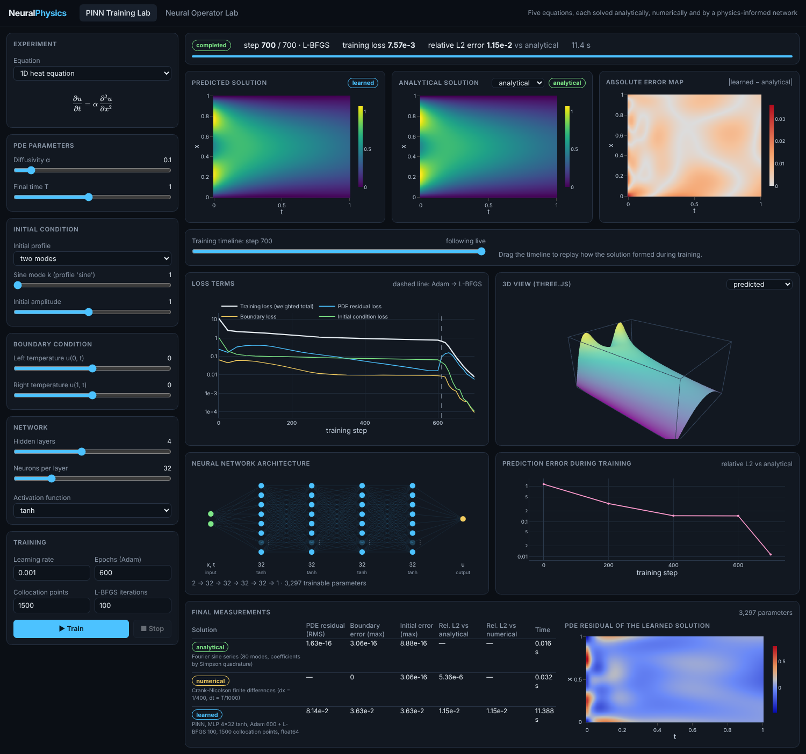
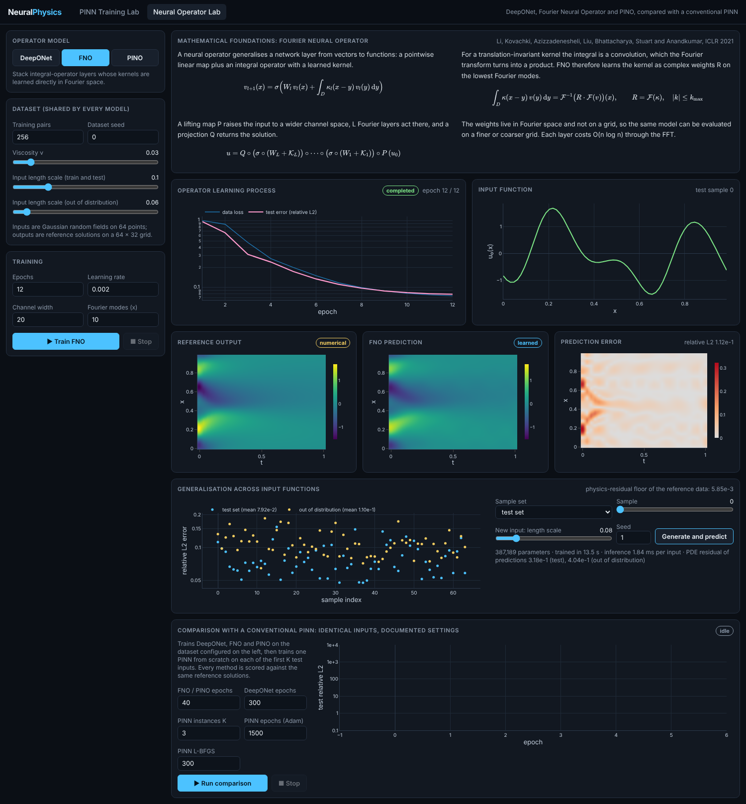

# NeuralPhysics

An interactive laboratory for physics-informed neural networks (PINNs) and neural operators.

NeuralPhysics solves differential equations three ways, **analytically**, **numerically** and with a
**neural network**, and measures how far apart the three are. Networks train on the server while the
browser shows the loss terms, the predicted field and its error evolving live. Nothing on screen is
decorative: every curve and field comes from a formula, a conventional solver, or a network trained with
PyTorch.



## Try it in 10 seconds (no Python)

Open **[`[demo/index.html](https://shailendradabral.github.io/Scientific-machine-learning/neuralphysics/demo/)`](https://shailendradabral.github.io/Scientific-machine-learning/neuralphysics/demo/)** in a browser.

The demo is one self-contained file. It replays recordings of real training runs for every experiment,
so play, pause, the training timeline and sample browsing all work, while the settings are fixed. To
train with your own settings, install the back end below.

## Run the full application

```bash
python -m venv .venv && source .venv/bin/activate            # Windows: .venv\Scripts\activate
pip install torch --index-url https://download.pytorch.org/whl/cpu
pip install -r requirements.txt
pip install -e core -e api
cd api && uvicorn app.main:app --port 8000
```

Open <http://localhost:8000>. Or, with Docker: `docker compose up --build`.

Python 3.10 or newer. Node is only needed to modify the front end. Details, GPU notes and
troubleshooting: [docs/INSTALLATION.md](docs/INSTALLATION.md).

## What is inside

### PINN Training Lab

Five equations, each with an analytical solution, a conventional solver and a PINN:

| Experiment | Equation | Analytical solution | Conventional solver |
| --- | --- | --- | --- |
| 1D heat | $u_t = \alpha u_{xx}$ | Fourier sine series | Crank-Nicolson |
| 2D heat | $u_t = \alpha(u_{xx} + u_{yy})$ | Separation of variables | Crank-Nicolson, sparse LU |
| Wave | $u_{tt} = c^2 u_{xx}$ | Standing waves | Explicit leapfrog |
| Burgers | $u_t + u u_x = \nu u_{xx}$ | Cole-Hopf transform | Fourier pseudo-spectral, ETDRK4 |
| Poisson | $\nabla^2 u = f$ | Manufactured solution | Five-point finite differences |

You can change the hidden layers, neurons, activation function, learning rate, epochs, collocation
points, boundary conditions, initial conditions and PDE parameters. The lab shows the network
architecture, the total, PDE-residual, boundary and initial-condition losses, the predicted and
analytical solutions, the absolute-error map and a 3D surface, with play, pause and stop acting on the
live optimiser. A timeline replays how the solution formed.

### Neural Operator Lab

DeepONet, the Fourier Neural Operator (FNO) and a physics-informed neural operator (PINO) learn the map
from an initial condition of the Burgers equation to its space-time solution. The lab explains the
mathematics of each architecture and shows the input function, the reference and predicted outputs, the
learning curves, and the error on a test set, an out-of-distribution set and freshly generated inputs. A
built-in comparison trains all three on one shared dataset and a conventional PINN on the same test
inputs, and records every setting with the results.



## Measured results

Default presets, seed 0, 2 CPU threads. How to regenerate them: [docs/REPRODUCIBILITY.md](docs/REPRODUCIBILITY.md).

| Experiment | Numerical vs analytical (rel. L2) | PINN vs analytical (rel. L2) | PINN PDE residual (rms) |
| --- | --- | --- | --- |
| 1D heat | 5.4e-6 | 6.8e-4 | 7.4e-3 |
| 2D heat | 1.3e-5 | 1.3e-3 | 5.3e-3 |
| Wave | 2.0e-6 | 3.8e-3 | 1.4e-2 |
| Burgers | 3.6e-10 | 5.6e-4 | 3.3e-3 |
| Poisson | 3.2e-5 | 5.2e-4 | 5.2e-3 |

| Operator comparison | Rel. L2, same 3 test inputs | Rel. L2, full test set | Time per new input |
| --- | --- | --- | --- |
| DeepONet | 0.119 | 0.103 | under 1 ms |
| FNO | 0.025 | 0.021 | about 1 ms |
| PINO | 0.038 | 0.032 | about 1 ms |
| PINN, trained per input | 0.004 | not applicable | 22 s |

Two things these tables show plainly: for these low-dimensional forward problems the conventional
solvers are far more accurate than the PINNs, and at the default loss weights PINO did not beat FNO.

## Use it from Python

```python
from neuralphysics.experiments import Experiment

result = Experiment("wave_1d", params={"c": 1.5}, config={"epochs": 2000}).run()
print(result.report())                         # one row each: analytical, numerical, learned
result.analytical.values, result.numerical.values, result.learned.values   # arrays on one grid
```

```bash
python -m neuralphysics.cli list
python -m neuralphysics.cli run burgers_1d --set nu=0.02 --epochs 2000 --lbfgs 500 --out results
python scripts/run_benchmark.py
```

More in [`examples/`](examples) and [docs/EXPERIMENTS.md](docs/EXPERIMENTS.md).

## Architecture

```
frontend/   React, TypeScript, Tailwind, Plotly.js, Three.js     renders only
api/        FastAPI: validation, one process per run, streaming  orchestrates only
core/       NumPy, SciPy, PyTorch: equations, solvers, networks  all the mathematics
```

The scientific core never imports a web framework, the service contains no numerical code, and the
front end computes no solution, residual or error.

## Documentation

| Document | Contents |
| --- | --- |
| [Installation](docs/INSTALLATION.md) | Demo mode, local install, Docker, development setup, troubleshooting |
| [Mathematics](docs/MATHEMATICS.md) | Every equation, analytical solution, numerical scheme, loss and error measure |
| [Architecture](docs/ARCHITECTURE.md) | PINN, DeepONet, FNO and PINO architectures; system design; adding an equation |
| [API](docs/API.md) | REST endpoints, WebSocket messages, binary frame format, client example |
| [Example experiments](docs/EXPERIMENTS.md) | Seven guided experiments with expected observations |
| [Reproducibility](docs/REPRODUCIBILITY.md) | Seeds, pinned versions, commands, expected values, tests |

## Repository layout

```
core/                 scientific core (pip install -e core) and its tests
api/                  FastAPI service and its tests
frontend/             web application; dist/ is the production build
demo/index.html       self-contained browser demo with recorded runs
docs/                 documentation
examples/             runnable Python examples
scripts/              record_demo.py, run_benchmark.py
results/              result files behind the tables above
requirements*.txt     runtime, development and pinned dependencies
Dockerfile, docker-compose.yml
```

## Tests

```bash
pip install -r requirements-dev.txt
(cd core && pytest)       # solvers, exact-solution residuals, architecture properties, short trainings
(cd api && pytest)        # codec, validation, one real streamed run with pause and resume
```

## Limitations

- Boundary conditions are Dirichlet; Neumann and periodic conditions are not adjustable in the PINN lab.
- Problems are one- and two-dimensional, and training is sized for a CPU.
- Run history is kept in memory and is lost when the service restarts.
- The service is meant for one user on a trusted machine: it has no authentication.

## Citing the methods

NeuralPhysics implements published methods. If you use it in academic work, please cite the original
papers listed in [docs/MATHEMATICS.md](docs/MATHEMATICS.md#references).

## License

MIT. See [LICENSE](LICENSE).
